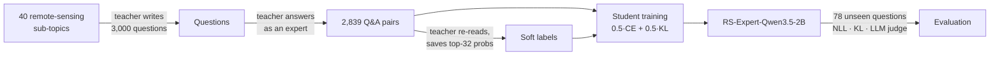

# RS-Expert: a small remote-sensing LLM via knowledge distillation

A single Google Colab notebook that distils a 9B-parameter teacher (**Qwen3.5-9B**) into a 2B student
(**Qwen3.5-2B**) specialised in **remote sensing and Earth observation**, with no human-written dataset.
The teacher writes the training questions and answers; the student learns from both the answers and the
teacher's token-level probability distributions.

**Result:** on 78 held-out questions the distilled 2B model beats the original 2B model with a **60 % win-rate**
(18 wins / 2 losses, LLM judge), lowers NLL on expert answers from 1.29 to 1.00 (−22 %) and reduces KL to the
teacher by 29 %, after about one hour on a single A100. The notebook in this repository is saved **with the
outputs of that run**.

> This is an end-to-end engineering project, not a new method. It combines well-known ideas: teacher-generated
> data (self-instruct), sequence- and logit-level knowledge distillation (Hinton et al., 2015; Kim & Rush, 2016)
> and context distillation of the system prompt. The value is in the complete, reproducible pipeline and the
> honest evaluation.

## How it works

1. **Questions.** The teacher is prompted ~500 times with a random sub-topic, asker persona and mix of question
   styles, and asked for 8 questions in JSON. Duplicates and near-duplicates are removed, sub-topics are
   balanced, and 80 domain questions are locked away as a test set *before* any answer exists.
   15 % of the questions are general (maths, Python, science) so the student keeps its general skills.
2. **Answers.** The teacher answers every question with an expert system prompt (temperature 0.7, top-p 0.8).
   Unfinished or repetitive answers are discarded.
3. **Soft labels.** The teacher re-reads each answer once and its top-32 next-token log-probabilities are saved
   for every answer token (≈ 60 KB per answer instead of ≈ 90 MB for the full 248k-word distribution).
4. **Training.** Full fine-tuning of the student on
   `loss = 0.5 · CE(teacher answer) + 0.5 · KL(teacher top-32 ‖ student)`, where the KL term includes an
   "everything else" bucket so both distributions are complete. The student sees the question **without** the
   system prompt, so the expert behaviour is baked into its weights (context distillation).
5. **Evaluation.** Base student vs distilled student on the held-out questions: NLL and KL against the teacher,
   plus pairwise judgement by the teacher in both answer orders (a win only counts if it survives swapping).

## Results

One run on 2026-10-16, NVIDIA A100-SXM4-80GB (Google Colab), ≈ 65 min end to end.

| Metric (78 held-out questions) | Base Qwen3.5-2B | **RS-Expert-Qwen3.5-2B** |
|---|---|---|
| NLL on teacher answers ↓ | 1.286 | **0.998** (−22 %) |
| KL to teacher, top-32 ↓ | 0.720 | **0.512** (−29 %) |

| Pairwise judgement (Qwen3.5-9B as judge, both orders) | Wins | Ties | Losses | Win-rate |
|---|---|---|---|---|
| RS-Expert vs base student | 18 | 58 | 2 | **60 %** |
| RS-Expert vs teacher | 0 | 45 | 33 | 29 % |

Win-rate counts a tie as half a win. Among the 20 decisive pairs the distilled model won 18–2
(two-sided binomial p ≈ 0.0004).

**Data:** 3,000 teacher-written questions (2,550 remote sensing + 450 general) → 2,839 Q&A pairs after
filtering (161 unfinished answers dropped) → 1.83 M answer tokens. Generation took 43 min.
**Training:** 2,777 examples, 2 epochs, 126 steps of 32k tokens, peak LR 1.5e-5 with 5 % warm-up and cosine
decay, fp32 weights with bf16 autocast, AdamW. 13 min.
**Student:** 1.88 B parameters, saved in bf16 safetensors (≈ 4 GB) with a chat template that answers directly
(thinking mode off by default).

**Caveats.** The judge is also the teacher, so it may favour answers that sound like its own; the data is
synthetic and inherits the teacher's mistakes; 78 questions is a small test set. Treat the numbers as
indicative, not as a benchmark.

The training set is in dataset.jsonl (2,839 Q&A pairs) and the side-by-side held-out answers in eval.json.

## Running it yourself

The notebook adapts to the GPU it finds:

| Colab GPU | Teacher | Student | Time |
|---|---|---|---|
| A100 | Qwen3.5-9B (bf16) | Qwen3.5-2B | ≈ 1 h |
| L4 | Qwen3.5-9B (4-bit) | Qwen3.5-0.8B | ≈ 1.5–2 h |
| T4 (free) | Qwen3-8B (4-bit) | Qwen3-0.6B | ≈ 2–3 h |

1. Open `RS_Expert.ipynb` in Google Colab (badge above, after replacing `YOUR_GITHUB_USERNAME`).
2. Runtime → Change runtime type → A100 GPU.
3. Optionally edit the **Settings** cell: domain (remote sensing / autonomous driving / custom), a Drive folder
   of your own PDFs to learn from, run size. In the Engine cell, `prepare_dirs()` sets the Google Drive output
   folder (`MyDrive/Aug26/Foundation/llm_distill` in this copy); change it to taste.
4. Runtime → Run all, and allow Google Drive access when asked. Everything is saved to Drive, and a
   disconnected session resumes where it stopped (finished steps are skipped).
5. Step 5 prints the evaluation table; the trained model is in `<Drive folder>/RS-Expert-…/final_model`.

Set `RUN_SIZE = "quick test"` for a 15-minute end-to-end check with a tiny dataset.

## Notebook structure

| Cell | What it does |
|---|---|
| Settings | model name, domain, run size, Drive on/off, model overrides |
| 1 · Install | pinned library versions, GPU check, fast Gated-DeltaNet kernels on Ampere+ |
| 2 · Engine | all logic (≈ 1,500 lines): resumable batched generation, top-k soft labels, distillation loss, memory-aware training loop (token-based batching, chunked logits, gradient checkpointing, bf16 autocast), evaluation |
| 3 · Setup | GPU-based plan (teacher/student/batch sizes), Drive folders, tokenizer compatibility check |
| Step 1–3 | questions → answers → teacher top-32 probabilities |
| Step 4 | distillation training, checkpoints, bf16 export |
| Step 5 | held-out evaluation: NLL, KL, pairwise LLM judge |

## Key takeaways

- Why logit distillation carries more signal than copying answers: the teacher's alternatives ("SAR 60 %,
  radar 30 %") teach the student what else is acceptable.
- Why a falling training loss means nothing without a held-out test: a 5-example version of this pipeline
  reaches training loss 0.17 and gets *worse* on unseen questions.
- GPU memory arithmetic for training (weights + gradients + optimizer ≈ 4× the weights) and the tricks that
  make a 2B full fine-tune fit: chunked logits over a 248k vocabulary, gradient checkpointing, length-sorted
  batches.
- Evaluation hygiene: lock the test set before generating answers, judge in both orders, report ties.

## Acknowledgements

Built on the Apache-2.0 [Qwen3.5](https://huggingface.co/Qwen) models, 🤗 Transformers, bitsandbytes and
flash-linear-attention.

## License

MIT. Models produced with this notebook inherit the Apache-2.0 licence of the Qwen base models.
